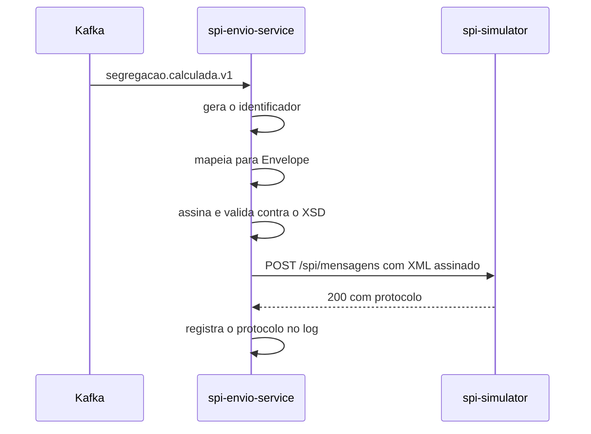

# spi-envio-service

Fluxo de envio primário ao SPI (Sistema de Pagamentos Instantâneos). Monta a mensagem do Banco Central, assina, valida contra o schema e envia.

Hoje ele trata um tipo de mensagem, o `pacs.008`. A estrutura dele é de **fluxo**, não de mensagem: quando o próximo tipo entrar, ele vira mais um caso de uso aqui dentro, não um projeto novo.

| Item | Valor |
|---|---|
| Porta | 8082 |
| Consome | `segregacao.calculada.v1` |
| Envia | `POST /spi/mensagens` no `spi-simulator` |
| Grupo de consumer | `spi-envio-service` |
| Spec | [spec do serviço](../spec/spi-envio-service/spec.md) |

## Por que ele existe

O serviço anterior resolve o problema tributário, mas fala a língua do negócio: valores em centavos, nomes, contas. O SPI (Sistema de Pagamentos Instantâneos) não entende essa língua. Ele entende ISO 20022, com uma variante nacional e um schema fechado.

Este serviço é a fronteira entre os dois mundos. É o único lugar que conhece a mensagem do Banco Central, e por isso é o único que quebra quando o schema muda.

## Escopo: um fluxo, vários tipos de mensagem

A unidade de deploy é o fluxo, não a mensagem. O `pacs.008` é o primeiro tipo tratado aqui, e não o único previsto.

| Se entrar | O que muda |
|---|---|
| `camt.055`, cancelamento | um mapper e um caso de uso, no mesmo serviço |
| `pacs.004`, devolução | o mesmo |
| `pacs.002`, status | fica no fluxo de retorno, que é outro serviço |

O nome do módulo não cita mensagem por isso. Um serviço chamado `pacs008-service` obrigaria a criar `camt055-service` e `pacs004-service`, cada um com o seu Dockerfile, o seu pipeline e a sua cópia do cliente HTTP.

## O que ele faz, passo a passo

```
segregacao.calculada.v1
        │
        ▼
1. gera o identificador da mensagem
        │
        ▼
2. mapeia para o envelope pacs.008
        │
        ▼
3. assina o documento
        │
        ▼
4. valida contra o XSD
        │
        ▼
5. envia por HTTP e registra o protocolo
```

**Passo 1, identificador.** O schema exige o formato `M` + 8 caracteres alfanuméricos maiúsculos + 23 alfanuméricos. O identificador é **derivado do E2EID**, então reenviar a mesma transação produz o mesmo identificador. Isso evita que um retry vire duas mensagens diferentes.

**Passo 2, mapeamento.** O `Pacs008Mapper` converte o evento no objeto `Envelope`, que tem duas partes: `AppHdr` (cabeçalho, com origem, destino e identificação da mensagem) e `Document` (o pagamento em si).

**Passo 3, assinatura.** O schema exige uma assinatura dentro do elemento `Sgntr`. O adaptador simulado monta uma assinatura estruturalmente válida.

**Passo 4, validação.** O XML é conferido contra o `pacs.008.spi.1.15.xsd`. Se não validar, nada é enviado. A validação não é opcional: XML torto que sai daqui falha no Banco Central, e o erro só aparece depois.

**Passo 5, envio.** O XML vai pela porta `EnvioSpi` para o adaptador HTTP, que faz o POST e recebe o protocolo.

## Anatomia da mensagem

```
Envelope
├── AppHdr                    cabeçalho do SPI
│   ├── Fr                    PSP de origem, identificado pelo ISPB
│   ├── To                    PSP de destino
│   ├── BizMsgIdr             identificador da mensagem
│   ├── MsgDefIdr             "pacs.008.spi.1.15"
│   ├── CreDt                 data de criação
│   └── Sgntr                 assinatura digital
└── Document
    └── FIToFICstmrCdtTrf
        ├── GrpHdr            identificador, data, quantidade
        └── CdtTrfTxInf
            ├── PmtId         EndToEndId
            ├── IntrBkSttlmAmt  valor em BRL com duas casas
            ├── ChrgBr        SLEV
            ├── Dbtr e Cdtr   pagador e recebedor
            ├── DbtrAcct e CdtrAcct
            ├── DbtrAgt e CdtrAgt
            └── Purp          IPAY
```

Um detalhe que confunde: o cabeçalho identifica o PSP por `FIId/FinInstnId/Othr/Id`, mas o corpo identifica por `ClrSysMmbId/MmbId`. Dois caminhos diferentes no mesmo XML, cada um exigido pelo schema.

## O perfil de assinatura do SPI

O SPI não aceita qualquer assinatura. Ele restringe o que o padrão W3C deixa aberto. As seis regras abaixo foram descobertas por validação, não por leitura de blog:

| Regra | Exigência |
|---|---|
| Canonicalização | apenas `xml-exc-c14n#` |
| Método de assinatura | apenas `rsa-sha256` |
| Método de resumo | apenas `sha256` |
| Referências | mínimo de 3 dentro do `SignedInfo` |
| `KeyInfo` | obrigatório, com atributo `Id` |
| `X509Data` | exige `X509IssuerSerial`, não o certificado |

Cada uma dessas restrições apareceu como erro de validação, uma por uma. Estão registradas no [ADR-0006](../docs/adr/0006-assinatura-simulada-perfil-spi.md).

## Como ele se integra



Os XSDs e o codec ficam dentro deste módulo. O simulador tem a própria cópia dos schemas, porque faz o papel de um sistema externo e não deve depender do código de quem envia. A decisão está no [ADR-0008](../docs/adr/0008-contrato-no-servico-de-envio.md).

## Estrutura do código

```
src/main/java/br/com/paymentslab/spienvio/
├── Application.java
├── pacs008/               Pacs008Codec, Assinador, AssinadorSimulado
├── entrada/evento/        SegregacaoCalculadaRecebida, ParticipanteRecebido
├── dominio/porta/saida/   EnvioSpi, Protocolo
├── adaptadores/
│   ├── entrada/mensageria/  SegregacaoConsumer, IdentificadorMensagem
│   └── saida/
│       ├── pacs008/         Pacs008Mapper
│       └── spi/             EnviadorHttp
├── comum/correlacao/      CorrelationId e os dois interceptores
└── configuracao/          ContratoConfig

src/main/resources/
├── xsd/                   pacs.008.spi.1.15.xsd e xmldsig.spi.1.0.xsd
├── application.yaml
└── logback-spring.xml
```

`SegregacaoCalculadaRecebida` é o modelo **do lado consumidor**, não o modelo do `split-service`. Isso é proposital: se o produtor mudar o formato, a quebra fica localizada aqui, e não espalhada.

## Origem dos schemas

Os arquivos de `src/main/resources/xsd` fazem parte do pacote oficial de schemas do SPI, publicado pelo Banco Central do Brasil.

| Item | Valor |
|---|---|
| Origem | https://www.bcb.gov.br/estabilidadefinanceira/comunicacaodados |
| Pacote | versão 5.12.1 |
| Extraído em | 2026-11-17 |
| Arquivos usados | `pacs.008.spi.1.15.xsd` e `xmldsig.spi.1.0.xsd` |

O pacote completo tem 28 schemas, exemplos e planilhas de regras. Nada disso é redistribuído aqui: apenas os dois arquivos necessários, com atribuição à origem.

**Atenção:** a pasta `xsd` é lida inteira pelo `jaxb2-maven-plugin`. Qualquer arquivo que não seja `.xsd` ali dentro quebra o build.

O `xmldsig.spi.1.0.xsd` é obrigatório porque o elemento `Sgntr` usa `xs:any` com validação estrita: sem ele na fábrica de validação, a mensagem assinada é recusada.

## Camada comum do fluxo

O que todo tipo de mensagem vai precisar já está isolado, para não ser copiado quando o segundo tipo entrar.

| Peça | Onde | Papel |
|---|---|---|
| `EnvioSpi` | `dominio/porta/saida` | porta de envio, independente do tipo de mensagem |
| `EnviadorHttp` | `adaptadores/saida/spi` | envia qualquer XML ao SPI e devolve o protocolo |
| `Assinador` | `pacs008/` | assinatura, dentro do próprio módulo |
| `CorrelationId` | `comum/correlacao` | identificador de correlação da transação |

### Correlação

O identificador vem no cabeçalho `X-Correlation-Id` da mensagem Kafka. Se não vier, é gerado.

1. `CorrelationIdRecordInterceptor` lê o cabeçalho e abre o escopo no MDC antes de o listener rodar.
2. Toda linha de log passa a imprimir `[correlationId]`.
3. `CorrelationIdHttpInterceptor` repete o cabeçalho na chamada ao simulador.
4. `afterRecord` fecha o escopo, para não vazar para a próxima mensagem.

Com isso a mesma transação é rastreável do evento até o protocolo de recebimento.

## Tecnologias e por quê

| Tecnologia | Versão | Papel |
|---|---|---|
| Java | 21 | linguagem, com records e `BigDecimal` para dinheiro |
| Spring Boot | 3.5.6 | contexto e actuator |
| spring-kafka | 3.3.10 | consumer do evento de segregação |
| JAXB | jakarta, no próprio módulo | objeto Java que vira XML |
| JAXP e XMLDSig | do próprio JDK | validação de schema e assinatura |
| RestClient | Spring 6.2 | envio HTTP com configuração fluente |
| JUnit 5, AssertJ, MockRestServiceServer | via Spring Boot | testes de unidade e de envio |
| JaCoCo | 0.8.16 | cobertura com gate no build |

## Como rodar

```bash
docker compose up -d
```

Ou isolado:

```bash
mvn -pl spi-envio-service spring-boot:run
```

Saúde: `http://localhost:8082/actuator/health`

## Como testar

```bash
mvn -pl spi-envio-service test
```

São 14 testes. Os principais:

| Teste | O que prova |
|---|---|
| `deve_gerar_mensagem_valida_contra_o_xsd` | o mapper produz mensagem conforme o schema |
| `deve_omitir_a_remessa_quando_a_mensagem_e_vazia` | campo opcional não é inventado |
| `deve_omitir_o_emissor_quando_a_agencia_e_ausente` | o mesmo, para a agência |
| `deve_derivar_do_end_to_end_id_quando_ele_tem_tamanho_suficiente` | identificador determinístico |
| `deve_enviar_o_xml_e_devolver_o_protocolo` | o envio HTTP com `MockRestServiceServer` |
| `deve_montar_assinar_validar_e_enviar` | o consumidor fecha o ciclo inteiro |
| `deve_usar_o_identificador_que_veio_no_cabecalho` | a correlação vem do Kafka |
| `deve_gerar_um_identificador_quando_o_cabecalho_nao_vem` | a correlação nunca fica vazia |
| `deve_fechar_o_escopo_depois_de_processar_a_mensagem` | o escopo não vaza entre mensagens |
| `deve_propagar_o_identificador_na_chamada_de_saida` | a correlação chega ao HTTP |

## Como adicionar um novo tipo de mensagem

1. Copiar o XSD para `src/main/resources/xsd/`, sem nenhum outro arquivo na pasta.
2. Ajustar o `jaxb2-maven-plugin` no `pom.xml` se o schema novo tiver outro namespace.
3. Criar o mapper no adaptador de saída, ao lado do `pacs008`.
4. Criar o caso de uso que monta, assina, valida e envia.
5. Criar o consumer do evento que dispara esse caso de uso.

Nenhum desses passos cria módulo, Dockerfile ou serviço novo no compose.

## Observabilidade

| Item | Valor |
|---|---|
| Volume | `pacs008_envios_total{resultado="enviado"}` e `pacs008_envios_total{resultado="falha"}` |
| Tempo | `pacs008_envio_seconds`, do recebimento do evento até o protocolo |
| Log | JSON no Elasticsearch, com o E2EID no campo `correlationId` |
| Erro | após 3 tentativas, a mensagem vai para `segregacao.calculada.v1-dlt`, com chave e correlação |

A métrica de falha conta tentativas, não mensagens: quatro tentativas viram quatro incrementos.

## O que ele não faz

| Não faz | Porque é de outro serviço |
|---|---|
| calcular IBS e CBS | `split-service` |
| decidir alíquota | `split-service` |
| receber a mensagem | `spi-simulator` |

## Limites conhecidos

- A assinatura é simulada. Sem valor criptográfico, mas estruturalmente válida. Quem tiver certificado troca o bean `Assinador`.
- A mensagem transporta o valor bruto. O tributo é calculado no outro serviço e não viaja no `pacs.008`.
- Não existe retry nem DLT (Dead Letter Topic) configurados. Se o envio falhar, a mensagem é reprocessada pelo Kafka e o log mostra o erro.
- O envio é síncrono dentro do consumer. Para produção, o correto seria publicar o resultado e desacoplar.
