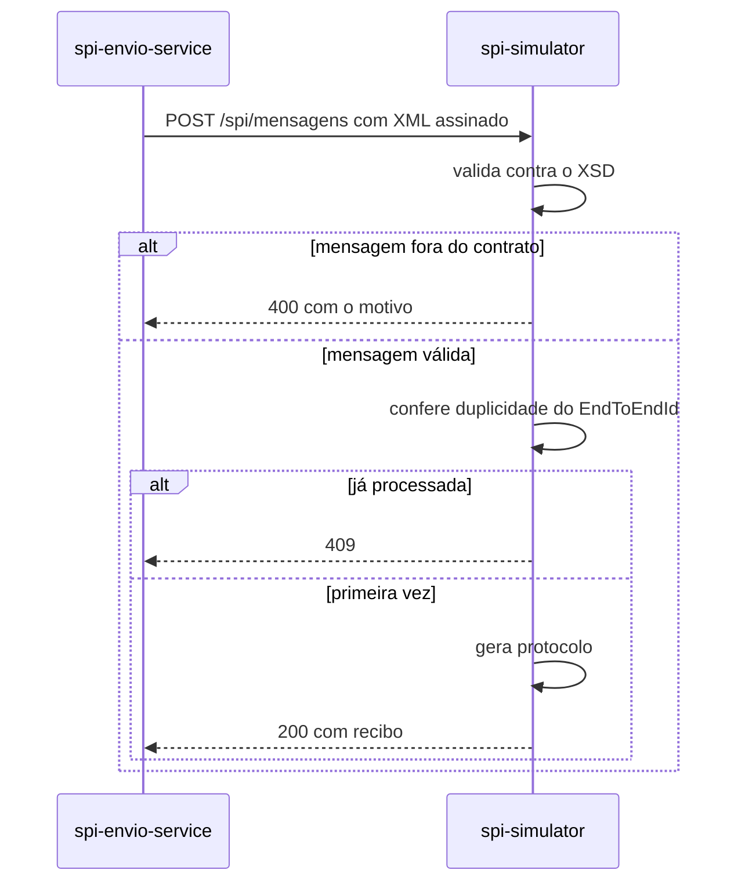

# spi-simulator

Dublê do SPI (Sistema de Pagamentos Instantâneos). Recebe a mensagem `pacs.008`, valida contra o schema, recusa o que estiver errado e devolve um protocolo de recebimento.

| Item | Valor |
|---|---|
| Porta | 8083 |
| Endpoint | `POST /spi/mensagens` |
| Consome | `application/xml` |
| Devolve | JSON com protocolo e data |
| Spec | [spec do serviço](../spec/spi-simulator/spec.md) |

## Por que ele existe

O destino real da mensagem é o SPI, do Banco Central. Ele exige conexão dedicada, certificado digital e habilitação como participante. Nada disso é possível num projeto de estudo.

Então o projeto tem um dublê. A diferença em relação a um dublê comum está no que ele faz com a mensagem: **valida de verdade**.

## Por que ele não é um eco

O caminho barato seria receber qualquer coisa e devolver `200`. Esse caminho não prova nada: um mapper errado passaria despercebido, e o erro só apareceria no Banco Central, meses depois.

Aqui ele confere o XML contra o mesmo XSD que o produtor usa. Se o `spi-envio-service` gerar um elemento fora do contrato, o erro aparece **na chamada**, com a mensagem do validador.

A decisão está registrada no [ADR-0010](../docs/adr/0010-simulador-valida.md).

## O que ele faz

```
POST /spi/mensagens (XML assinado)
        │
        ▼
   valida contra o XSD
        │
        ├── inválido ──────────► 400 com o motivo
        │
        ▼
   extrai o EndToEndId
        │
        ├── repetido ──────────► 409
        │
        ▼
   gera o protocolo ─────────► 200 com recibo
```

| Situação | Resposta | Corpo |
|---|---|---|
| mensagem válida | `200` | protocolo, data de recebimento e EndToEndId |
| fora do contrato | `400` | motivo da validação |
| EndToEndId repetido | `409` | identificador repetido |

A recusa de duplicidade existe porque o SPI real não aceita a mesma transferência duas vezes. Simular esse comportamento obriga o produtor a pensar em idempotência.

## Contrato da API

**Requisição**

```http
POST /spi/mensagens
Content-Type: application/xml

<Envelope xmlns="https://www.bcb.gov.br/pi/pacs.008/1.15">
  <AppHdr> ... </AppHdr>
  <Document> ... </Document>
</Envelope>
```

**Resposta de sucesso**

```json
{
  "protocolo": "SIM-2026-11-17-000001",
  "recebidoEm": "2026-11-17T09:19:39.641Z",
  "endToEndId": "E9999901020260101120000000000010"
}
```

**Resposta de contrato inválido**

```json
{
  "erro": "mensagem fora do contrato",
  "detalhe": "cvc-complex-type.2.4.b: ..."
}
```

**Resposta de duplicidade**

```json
{
  "erro": "mensagem ja processada",
  "endToEndId": "E9999901020260101120000000000010"
}
```

## Como ele se integra



## Estrutura do código

```
src/main/java/br/com/paymentslab/spisimulador/
├── Application.java
├── SimuladorController.java   recebe, valida, protocola
├── SimuladorConfig.java       declara o validador
└── ValidadorPacs008.java      valida o schema e extrai o EndToEndId

src/main/resources/xsd/       cópia própria dos dois schemas
```

O simulador não tem camada de domínio própria, porque ele não tem regra de negócio. Ele tem um contrato e um comportamento de borda.

## Tecnologias e por quê

| Tecnologia | Versão | Papel |
|---|---|---|
| Java | 21 | linguagem |
| Spring Boot | 3.5.6 | contexto, MVC e actuator |
| Jackson | via Spring Boot | serialização da resposta em JSON |
| JAXP | do próprio JDK | validação do schema e leitura do identificador |
| `MockMvc` | via Spring Boot | testes de integração sem subir servidor |
| JaCoCo | 0.8.16 | cobertura com gate no build |

O simulador tem a **própria cópia** dos dois XSDs e a própria validação. Ele faz o papel de um sistema externo, então não depende do código de quem envia. Se o emissor gerar um XML torto, a recusa acontece aqui, sem código compartilhado que mascare o erro.

## Como rodar

```bash
docker compose up -d
```

Ou isolado:

```bash
mvn -pl spi-simulator spring-boot:run
```

Saúde: `http://localhost:8083/actuator/health`

## Como testar

```bash
mvn -pl spi-simulator test
```

São 7 testes. Os três de integração usam `MockMvc`, os quatro de unidade exercitam o validador.

| Teste | O que prova |
|---|---|
| `deve_aceitar_mensagem_assinada_e_conforme` | caminho feliz com `200` e protocolo |
| `deve_recusar_mensagem_sem_assinatura` | `400` quando o `Sgntr` está vazio |
| `deve_recusar_mensagem_duplicada` | `409` na segunda tentativa com o mesmo EndToEndId |
| `deve_aceitar_mensagem_conforme_e_extrair_o_end_to_end_id` | validação e leitura do identificador |
| `deve_recusar_mensagem_fora_do_contrato` | schema recusa elemento fora do contrato |
| `deve_recusar_mensagem_sem_end_to_end_id` | XML válido sem o identificador é recusado |
| `deve_recusar_xml_malformado_ao_extrair_identificador` | XML quebrado não derruba o serviço |

Cada teste usa um EndToEndId próprio, porque o simulador guarda os identificadores processados em memória e o contexto do Spring é compartilhado entre os métodos. A mensagem válida vem de um fixture assinado, com o identificador trocado por teste.

## Observabilidade

| Item | Valor |
|---|---|
| Volume | `simulador_mensagens_total{resultado="aceita"}`, `recusada` e `duplicada` |
| Tempo | `simulador_validacao_seconds` |
| Log | JSON no Elasticsearch, com o campo `servico` |

O simulador não publica em Kafka, então não tem tópico de erro. A recusa é a resposta HTTP, que já é o comportamento esperado de um sistema externo.

## O que ele não faz

| Não faz | Por quê |
|---|---|
| processar pagamento | ele é a borda, não o núcleo |
| calcular tributo | não é papel do SPI |
| autenticar | o SPI real usa certificado, e isso está fora do escopo |
| persistir protocolos | guarda em memória, para simplificar |

## Limites conhecidos

- Os EndToEndIds processados ficam em memória. Reiniciar o container limpa o histórico, e a mesma mensagem volta a ser aceita.
- Não há TLS nem autenticação.
- A validação cobre o schema. Regra de negócio do SPI, como limite de valor, não é simulada.
