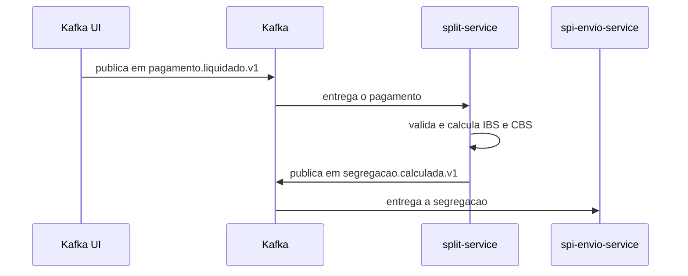

# split-service

Calculadora da segregação tributária. Consome o pagamento liquidado, calcula quanto do valor é IBS, quanto é CBS e quanto sobra para o estabelecimento.

| Item | Valor |
|---|---|
| Porta | 8081 |
| Consome | `pagamento.liquidado.v1` |
| Publica | `segregacao.calculada.v1` |
| Grupo de consumer | `split-service` |
| Spec | [spec do serviço](../spec/split-service/spec.md) |

## Por que ele existe

Quando um pagamento liquida, o valor não vai inteiro para o estabelecimento. Uma parte é tributo e precisa ser separada na hora. Quem faz essa conta é o prestador de pagamento, não a plataforma do governo: o Manual de Operações do CGIBS diz que a Plataforma Pública não executa regra de negócio, só recebe, valida e roteia.

Este serviço é essa conta. Ele é o único lugar do projeto que sabe qual é a alíquota.

## O que ele faz

```
pagamento.liquidado.v1
        │
        ▼
   valida o pagamento
        │
        ▼
   calcula IBS e CBS
        │
        ▼
   verifica se a soma fecha
        │
        ▼
segregacao.calculada.v1
```

1. **Valida.** O modelo de domínio recusa valor zero ou negativo, E2EID (End-to-End ID, identificador único ponta a ponta) vazio e data ausente. Recusar na entrada evita propagar lixo para os outros serviços.
2. **Calcula.** Aplica as alíquotas de transição de 2026 e trunca para baixo.
3. **Confere.** A invariante `bruto = líquido + IBS + CBS` é verificada no construtor do `Segregacao`. Se não fechar, o objeto nem é criado.
4. **Publica.** Envia o evento com chave igual ao E2EID, carregando os valores **e** os dados do pagamento.

## A conta, com números

Alíquotas usadas, que são as de transição de 2026:

| Tributo | Alíquota |
|---|---|
| IBS (Imposto sobre Bens e Serviços) | 0,1% |
| CBS (Contribuição sobre Bens e Serviços) | 0,9% |

Para um pagamento de **R$ 100,00**, que são 10.000 centavos:

```
IBS = 10.000 × 0,001 = 10 centavos  = R$ 0,10
CBS = 10.000 × 0,009 = 90 centavos  = R$ 0,90
líquido = 10.000 − 10 − 90          = R$ 99,00
```

Para o pagamento de teste que rodou na demonstração, **R$ 7.500,00**:

```
IBS = R$ 7,50
CBS = R$ 67,50
líquido = R$ 7.425,00
```

### Por que truncar e não arredondar

Imagine 111 centavos. A CBS dá 0,999 centavo. Arredondar para cima reteria 1 centavo, que é mais do que o devido. Arredondar tributo para cima é erro fiscal, então o cálculo sempre **descarta a fração**.

O teste `deve_truncar_para_baixo_e_nunca_arredondar_para_cima` prova os dois lados da fronteira: 111 centavos geram zero de CBS, e 112 centavos geram 1 centavo.

## Como ele se integra



A chave da mensagem publicada é o E2EID. Isso faz duas coisas: garante ordem por transação dentro da partição e permite correlação direta com o próximo serviço.

### Por que o evento leva os dados do pagamento

O `spi-envio-service` precisa de nome, documento, conta e ISPB (Identificador do Sistema de Pagamentos Brasileiro) do pagador e do recebedor para montar a mensagem. Se ele tivesse que perguntar ao `split-service` por HTTP, existiria acoplamento síncrono e um ponto de falha a mais.

Por isso o evento carrega o estado completo. A decisão está registrada no [ADR-0009](../docs/adr/0009-evento-carrega-estado.md).

## Estrutura do código

```
src/main/java/br/com/paymentslab/split/
├── Application.java
├── entrada/evento/   PagamentoRecebido, ParticipanteRecebido, MapeadorPagamento
├── dominio/
│   ├── model/      ValorMonetario, Participante, PagamentoLiquidado, Segregacao
│   ├── servico/    CalculoSegregacao (porta) e CalculoSegregacaoPadrao
│   └── porta/
│       ├── entrada/  ProcessarPagamento
│       └── saida/    PublicadorEvento
├── aplicacao/
│   ├── evento/               ParticipanteEvento, SegregacaoCalculadaEvento
│   └── usecase/implementacao/ ProcessarPagamentoImpl
├── adaptadores/
│   ├── entrada/mensageria/   PagamentoConsumer
│   └── saida/mensageria/     KafkaPublicador
└── configuracao/             CasosDeUsoConfig
```

`entrada/evento` é o modelo de borda, e `dominio/model` é o modelo de negócio. Os dois existem separados por um motivo: se o produtor mudar o formato do JSON, a mudança para no mapeador. E evento inválido é recusado ali, com motivo e métrica, em vez de estourar dentro do desserializador.

A regra que faz isso ser hexagonal: **`dominio` e `aplicacao` não importam Spring nem Kafka**. O que liga o mundo externo ao caso de uso são as portas, e quem faz a ligação é o `CasosDeUsoConfig`.

## Tecnologias e por quê

| Tecnologia | Versão | Papel |
|---|---|---|
| Java | 21 | linguagem, com records para os modelos imutáveis |
| Spring Boot | 3.5.6 | contexto, configuração e actuator |
| spring-kafka | 3.3.10 | consumer e producer |
| Jackson | via Spring Boot | serialização JSON dos eventos |
| JUnit 5 e AssertJ | via Spring Boot | testes |
| Mockito | via Spring Boot | mock do `KafkaTemplate` no teste do publicador |
| JaCoCo | 0.8.16 | cobertura com gate de 80% linha e 70% branch |

## Como rodar

```bash
docker compose up -d
```

Ou isolado, com Kafka já no ar:

```bash
mvn -pl split-service spring-boot:run
```

Saúde: `http://localhost:8081/actuator/health`

## Como testar

```bash
mvn -pl split-service test
```

São 19 testes, sem broker e sem Docker. Os principais:

| Teste | O que prova |
|---|---|
| `deve_calcular_cbs_e_ibs_sobre_mil_reais` | a conta básica |
| `deve_truncar_para_baixo_e_nunca_arredondar_para_cima` | a fronteira do truncamento |
| `a_segregacao_deve_fechar_em_qualquer_valor` | a invariante em 2.000 valores |
| `os_tributos_nunca_devem_passar_do_valor_bruto` | líquido nunca fica negativo |
| `deve_publicar_evento_com_os_dados_do_pagamento` | o evento sai com o estado completo |

## Observabilidade

| Item | Valor |
|---|---|
| Volume | `split_pagamentos_total{resultado="calculado"}` e `split_pagamentos_total{resultado="falha"}` |
| Tempo | `split_calculo_seconds` |
| Log | JSON no Elasticsearch, consultado no Kibana |
| Erro | após 3 tentativas, a mensagem vai para `pagamento.liquidado.v1-dlt` |

As métricas ficam no consumer, não no caso de uso: o domínio não importa biblioteca de observabilidade.

## O que ele não faz

| Não faz | Porque é de outro serviço |
|---|---|
| gerar XML | `spi-envio-service` |
| chamar o SPI | `spi-envio-service` |
| assinar mensagem | `spi-envio-service` |
| decidir alíquota por vigência | não implementado ainda, ver dúvida D1 da spec |

## Limites conhecidos

- As alíquotas são constantes de 2026. Trocar por tabela versionada por vigência é o próximo passo.
- A regra de proporcionalidade exata do Manual de Operações ainda não foi implementada. A premissa atual está documentada no [ADR-0002](../docs/adr/0002-calculo-isolado-em-estrategia.md).
